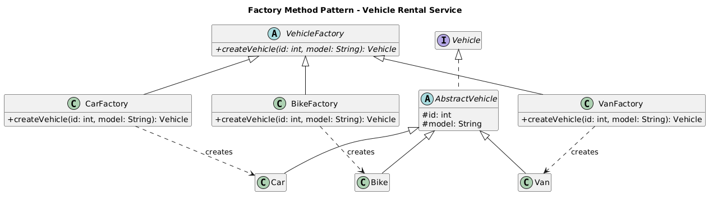
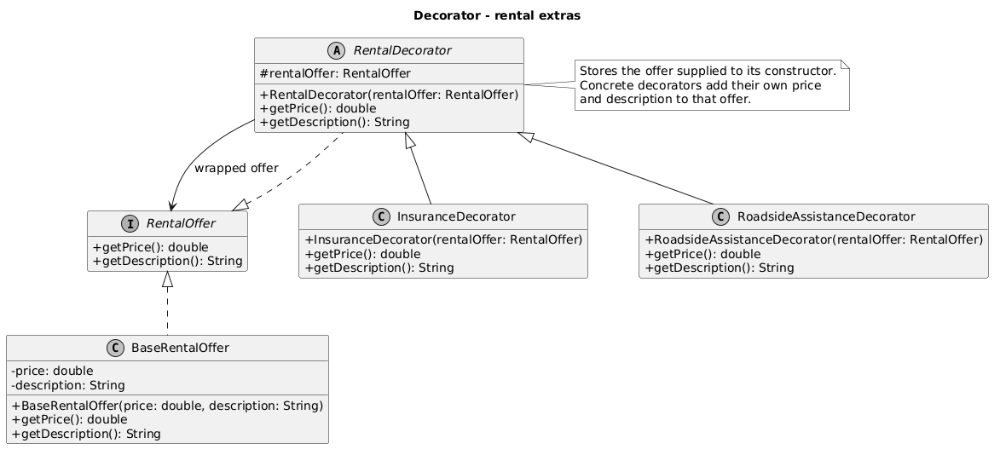
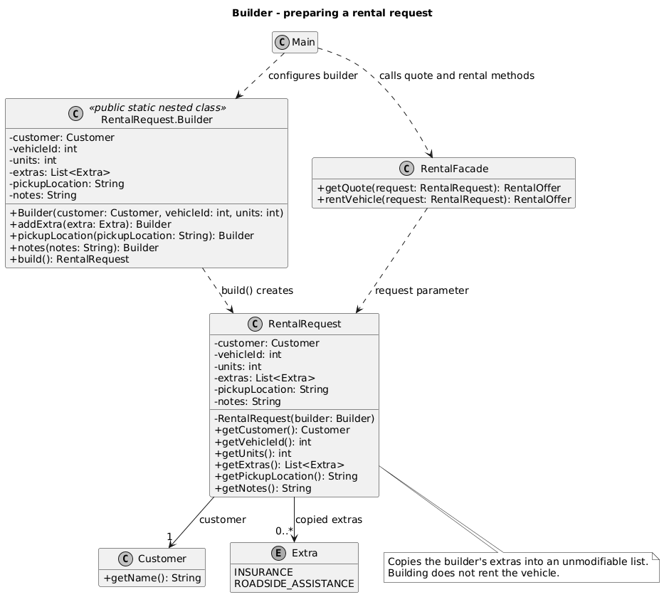
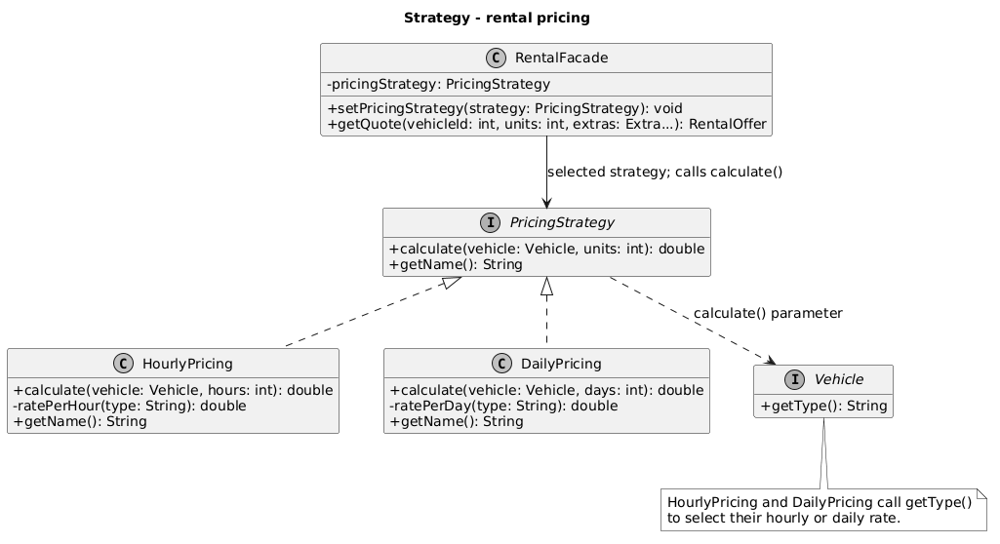
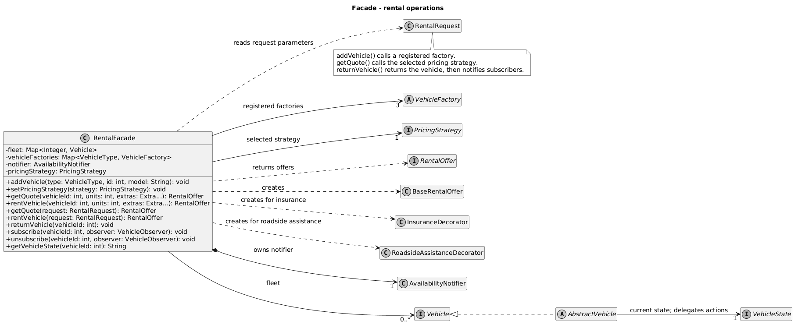

# Vehicle Rental Service

A console-based vehicle rental service written in Java. The project demonstrates seven design patterns working together: Factory Method, Strategy, Decorator, Facade, State, Observer, and Builder.

Customers can rent cars, bikes, and vans, choose hourly or daily pricing, add insurance or roadside assistance, and subscribe to a vehicle to receive a notification when it is returned. The application stores its data in memory.

## Requirements

- JDK 17 or newer
- A terminal or an IDE such as IntelliJ IDEA
- Maven to run the JUnit 5 tests

The application uses the Java standard library. Tests use JUnit 5, which Maven downloads on the first test run.

## How to run

Open a terminal in the project root directory and compile the source files:

```bash
javac --release 17 -d out src/*.java
```

Run the complete demonstration:

```bash
java -cp out Main
```

`Main` demonstrates all seven patterns in one rental scenario.

In IntelliJ IDEA, open the project, set the Project SDK to JDK 17 or newer, then run `src/Main.java`. You can also open `pom.xml` as a Maven project and run the tests from the IDE.

## Tests

From the project root, run:

```bash
mvn test
```

Maven compiles `src/` and runs the tests in `tests/`. The suite currently runs 63 tests covering vehicle factories, both pricing strategies, decorators, state changes, subscriptions, the request builder, facade operations, and the main demonstration. It includes invalid inputs and a complete rental and return scenario.

A successful run ends with `BUILD SUCCESS`. Test reports are saved in `target/surefire-reports/`.

## Design patterns

| Pattern | Main classes | Purpose |
| --- | --- | --- |
| Factory Method | `VehicleFactory`, `CarFactory`, `BikeFactory`, `VanFactory` | Defines a vehicle-creation method in an abstract creator. Each concrete factory decides which vehicle class to instantiate. |
| Strategy | `PricingStrategy`, `HourlyPricing`, `DailyPricing` | Allows the rental price calculation to change between hourly and daily pricing. |
| Decorator | `RentalOffer`, `RentalDecorator`, `InsuranceDecorator`, `RoadsideAssistanceDecorator` | Adds optional services and their costs to a base rental offer without changing the original offer class. |
| Facade | `RentalFacade` | Provides one simple interface for vehicle creation, quotes, rentals, returns, and subscriptions. |
| State | `VehicleState`, `AvailableState`, `RentedState` | Controls vehicle behavior according to its current availability. It rejects renting an already rented vehicle and returning an available vehicle. |
| Observer | `AvailabilityNotifier`, `VehicleObserver`, `Customer` | Notifies subscribed customers when a vehicle is successfully returned. |
| Builder | `RentalRequest.Builder`, `RentalRequest` | Builds a rental request with customer, vehicle, duration, extras, pickup location, and notes. |

### Factory Method structure

`VehicleFactory` is the abstract creator and declares the `createVehicle(id, model)` factory method. `CarFactory`, `BikeFactory`, and `VanFactory` override that method to create their corresponding concrete products.

The `RentalFacade` keeps a mapping from `VehicleType` to the appropriate concrete factory. When `addVehicle()` is called, the facade selects the creator and delegates object creation to its factory method.

## Application flow

The full demo performs the following steps:

1. Creates a preview car through `CarFactory`, then adds a car, bike, and van through `RentalFacade`.
2. Shows daily and hourly quotes for the car.
3. Builds a rental request with a customer, duration, extras, pickup location, and notes.
4. Gets a daily quote for the request, including insurance and roadside assistance.
5. Subscribes Olzhas and Alisher to the car, then unsubscribes Alisher.
6. Rents the car and shows its state changing from `Available` to `Rented`.
7. Tries to rent the same car again and shows the rejection.
8. Returns the car, notifies Olzhas, and shows the `Available` state.

### Example rental calculation

The demo rents a car for two days:

- Base rental: 10,000 tenge × 2 days = 20,000 tenge
- Insurance: 2,000 tenge
- Roadside assistance: 1,500 tenge
- Total: 23,500 tenge

Each extra is charged once per rental.

Building a request or checking a quote does not change the vehicle state. A successful rental changes the state to `Rented`; returning it changes the state back to `Available`. Customers remain subscribed until they unsubscribe.

## Project structure

```text
src/
├── Main.java
├── Vehicle.java
├── AbstractVehicle.java
├── Car.java
├── Bike.java
├── Van.java
├── VehicleType.java
├── VehicleFactory.java
├── CarFactory.java
├── BikeFactory.java
├── VanFactory.java
├── RentalFacade.java
├── RentalRequest.java
├── VehicleState.java
├── AvailableState.java
├── RentedState.java
├── VehicleObserver.java
├── AvailabilityNotifier.java
├── Customer.java
├── PricingStrategy.java
├── HourlyPricing.java
├── DailyPricing.java
├── Extra.java
├── RentalOffer.java
├── BaseRentalOffer.java
├── RentalDecorator.java
├── InsuranceDecorator.java
└── RoadsideAssistanceDecorator.java
```

`tests/` contains the JUnit tests, `pom.xml` configures Maven, and `docs/` contains the UML images.

## Team contributions

| Student | Patterns | Contribution |
| --- | --- | --- |
| Abdraissov Altair | Factory Method, Decorator | Implemented the vehicle classes and Factory Method creators, added insurance and roadside-assistance decorators, and prepared the main demonstration. |
| Alimbayev Alisher | Strategy, Facade | Implemented hourly and daily pricing and connected vehicle creation, pricing, and extras through the facade. Corrected the van type returned by `Van.getType()`. |
| Assemgazy Olzhas | State, Observer, Builder | Implemented vehicle states, customer subscriptions and availability notifications, and the rental request builder. Connected them to the facade and added the JUnit tests. |

## UML class diagrams

The overview groups the main classes by responsibility. These boxes are visual groups, not Java packages. The detail diagrams show the members used by each pattern; other methods and constructors are omitted to keep them readable. `RentalRequest.Builder` is a public static nested class.

Solid lines with open arrowheads show stored references. Dashed arrows show dependencies such as method calls, parameters, or object creation. A hollow triangle with a solid line shows inheritance; a hollow triangle with a dashed line shows interface implementation. The filled diamond marks the notifier owned by the facade.


The overview shows `Main` as the client, the concrete Factory Method creators, and the factories stored by the facade.

### Factory Method

`CarFactory`, `BikeFactory`, and `VanFactory` create the matching vehicle classes. Each vehicle inherits the `Vehicle` implementation from `AbstractVehicle`.



### Decorator

`InsuranceDecorator` and `RoadsideAssistanceDecorator` wrap a `RentalOffer` and add their charge and description. The wrapped offer stays unchanged.



### State

`AbstractVehicle` stores a `VehicleState` and delegates rent and return actions to it. `AvailableState` allows renting and rejects a return. `RentedState` rejects another rental and allows returning the vehicle.


### Observer

`AvailabilityNotifier` stores observers by vehicle ID. The facade first returns the vehicle, then notifies its subscribers. A failed return sends no notification. Subscriptions stay active until removed, and subscribing the same customer object twice does not produce duplicate messages.


### Builder

`RentalRequest.Builder` is a public static nested class. Its constructor takes the customer, vehicle ID, and positive rental duration. Extras, pickup location, and notes are optional. The default pickup location is `Rental office`.

`build()` creates a request with an unmodifiable copy of the extras. Reusing the builder does not change an earlier request. The facade reads the completed request in `getQuote(request)` and `rentVehicle(request)`. Building a request does not rent a vehicle or fix its price; pricing uses the strategy currently selected in the facade.



### Strategy

`RentalFacade` stores a `PricingStrategy` and calls it to calculate the base price. `setPricingStrategy()` switches between hourly and daily pricing. Both implementations read the vehicle type to choose a rate.



### Facade

`RentalFacade` connects vehicle creation, pricing, extras, rentals, returns, and subscriptions. It calls the vehicle methods for renting and returning; `AbstractVehicle` delegates those calls to its current state.


