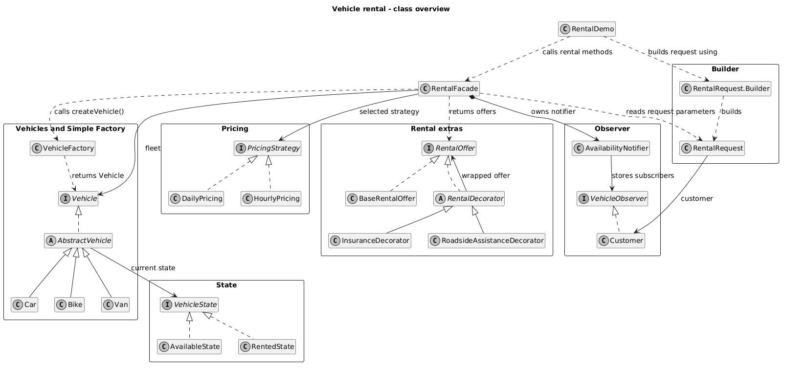
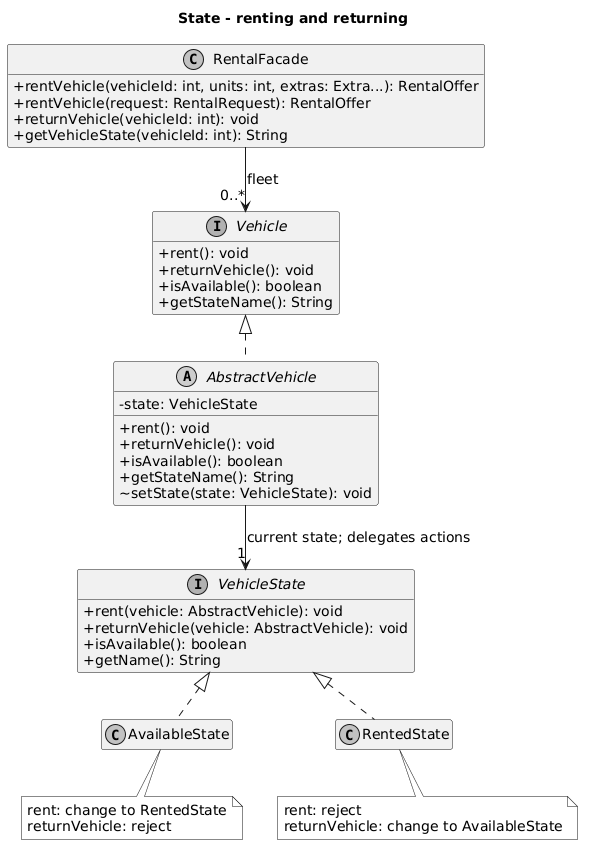

# Vehicle rental service

We built a vehicle rental service in Java to practice design patterns. Customers can rent a car, bike, or van, choose hourly or daily pricing, and add insurance or roadside assistance. They can also subscribe to a vehicle and get a message when it is returned. The program runs in the console and keeps its data in memory.

## Run

Install JDK 17 or newer. From the project folder, run:

```bash
javac --release 17 -d out src/*.java
java -cp out RentalDemo
```

`RentalDemo` runs the full example. `Main` is a shorter example of creating a vehicle and adding extras. Run it with `java -cp out Main`.

## Patterns

| Pattern | Main classes | Purpose |
| --- | --- | --- |
| Simple Factory | `VehicleFactory`, `Car`, `Bike`, `Van` | Creates a vehicle from its type. |
| Strategy | `PricingStrategy`, `HourlyPricing`, `DailyPricing` | Calculates the base price by hour or day. |
| Decorator | `RentalOffer`, `RentalDecorator`, `InsuranceDecorator`, `RoadsideAssistanceDecorator` | Adds extras to the base offer. |
| Facade | `RentalFacade` | Provides methods for quotes, rentals, returns, and subscriptions. |
| State | `VehicleState`, `AvailableState`, `RentedState` | Allows renting an available vehicle and returning a rented vehicle. |
| Observer | `AvailabilityNotifier`, `VehicleObserver`, `Customer` | Notifies customers subscribed to a returned vehicle. |
| Builder | `RentalRequest.Builder`, `RentalRequest` | Builds a rental request with customer details, extras, and pickup information. |

`VehicleFactory` uses a static method and a switch, so it is a Simple Factory. Factory Method and Abstract Factory use different structures.

## Work distribution

| Student | Patterns | Contribution |
| --- | --- | --- |
| Abdraissov Altair | Simple Factory, Decorator | Wrote the vehicle classes and factory, added insurance and roadside assistance decorators, and created the first `Main` example. |
| Alimbayev Alisher | Strategy, Facade | Added hourly and daily pricing and connected vehicle creation, pricing, and extras through the facade. Created `RentalDemo` and fixed the van type. |
| Assemgazy Olzhas | State, Observer, Builder | Added vehicle states, customer subscriptions and notifications, and the rental request builder. Connected them to the facade and updated the demo. |

## Rental flow

The demo starts with three vehicles and shows daily and hourly quotes. It then uses the builder to prepare a two-day car rental with insurance, roadside assistance, a customer, a pickup location, and notes. The facade calculates the price and rents the car. Trying to rent the same car again gives an error.

Two customers subscribe to the car, and one unsubscribes. When the car is returned, the remaining subscriber receives a console message.

A car costs 10,000 tenge per day. In the demo, two days cost 20,000 tenge, insurance adds 2,000, and roadside assistance adds 1,500. The total is 23,500 tenge. Each extra is charged once for the rental.

Building a request or checking a price leaves the vehicle available. Renting changes its state to `Rented`, and returning changes it back to `Available`. Customers stay subscribed until they unsubscribe. Subscribing the same customer object twice still produces only one message per return.

The rental duration is measured in days or hours, depending on the pricing strategy selected in the facade. Requests do not save that strategy or a fixed price, so the price is calculated using the current strategy. Pickup details and notes are saved as text.

## UML class diagram

The overview groups the main classes by responsibility. These boxes are visual groups, not Java packages. The detail diagrams show the members used by each pattern; other methods and constructors are left out to keep them readable. `RentalRequest.Builder` is a public static nested class.

Solid arrows show stored references, and dotted arrows show dependencies such as method calls or parameters. Hollow triangles show inheritance or interface implementation. The filled diamond marks the notifier owned by the facade.



### State

Each vehicle delegates rent and return actions to its current state.



### Observer

Customers subscribe to a vehicle. After a successful return, the notifier tells its subscribers that the vehicle is available.


### Builder

The builder collects rental details and creates a request that can be passed to the facade.


