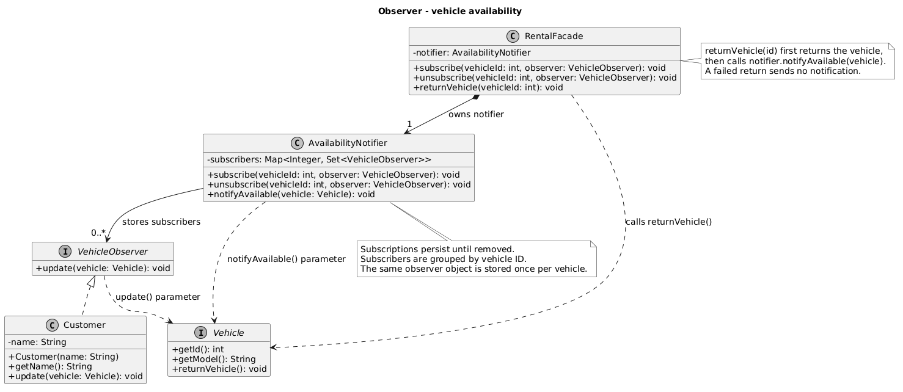

# Vehicle Rental Service

A console-based vehicle rental service written in Java. The project demonstrates seven design patterns working together: Factory Method, Strategy, Decorator, Facade, State, Observer, and Builder.

Customers can rent cars, bikes, and vans, choose hourly or daily pricing, add insurance or roadside assistance, and subscribe to a vehicle to receive a notification when it is returned. The application stores its data in memory.

## Requirements

- JDK 17 or newer
- A terminal or an IDE such as IntelliJ IDEA

The project does not require external libraries or a build tool.

## How to Run

Open a terminal in the project root directory and compile the source files:

```bash
javac --release 17 -d out src/*.java
```

Run the complete demonstration:

```bash
java -cp out Main
```

**Run `Main` for the full demonstration.** It first shows Factory Method and Decorator, then starts `RentalDemo`, which demonstrates the complete rental flow through the facade.

You can also run only the rental-system scenario:

```bash
java -cp out RentalDemo
```

In IntelliJ IDEA, open the project, set the Project SDK to JDK 17 or newer, then run `src/Main.java`.

## Design Patterns

| Pattern | Main classes | Purpose |
| --- | --- | --- |
| **Factory Method** | `VehicleFactory`, `CarFactory`, `BikeFactory`, `VanFactory` | Defines a vehicle-creation method in an abstract creator. Each concrete factory decides which vehicle class to instantiate. |
| **Strategy** | `PricingStrategy`, `HourlyPricing`, `DailyPricing` | Allows the rental price calculation to change between hourly and daily pricing. |
| **Decorator** | `RentalOffer`, `RentalDecorator`, `InsuranceDecorator`, `RoadsideAssistanceDecorator` | Adds optional services and their costs to a base rental offer without changing the original offer class. |
| **Facade** | `RentalFacade` | Provides one simple interface for vehicle creation, quotes, rentals, returns, and subscriptions. |
| **State** | `VehicleState`, `AvailableState`, `RentedState` | Controls vehicle behavior according to its current availability. It rejects renting an already rented vehicle and returning an available vehicle. |
| **Observer** | `AvailabilityNotifier`, `VehicleObserver`, `Customer` | Notifies subscribed customers when a vehicle is successfully returned. |
| **Builder** | `RentalRequest.Builder`, `RentalRequest` | Builds a rental request with customer, vehicle, duration, extras, pickup location, and notes. |

### Factory Method Structure

`VehicleFactory` is the abstract creator and declares the `createVehicle(id, model)` factory method. `CarFactory`, `BikeFactory`, and `VanFactory` override that method to create their corresponding concrete products.

The `RentalFacade` keeps a mapping from `VehicleType` to the appropriate concrete factory. When `addVehicle()` is called, the facade selects the creator and delegates object creation to its factory method. There is no static creation method with a switch statement.

This makes the implementation Factory Method rather than Simple Factory: the creation operation is declared by an abstract creator and implemented by concrete creator subclasses.

## Application Flow

The full demo performs the following steps:

1. Creates a car through `CarFactory` to demonstrate Factory Method.
2. Wraps a base rental offer with insurance and roadside assistance decorators.
3. Creates a fleet containing a car, a bike, and a van through `RentalFacade`.
4. Calculates quotes using daily and hourly pricing strategies.
5. Builds a rental request with a customer, vehicle, duration, extras, pickup location, and notes.
6. Calculates the request quote and rents the selected vehicle.
7. Attempts to rent the same vehicle again and demonstrates that the State pattern rejects the operation.
8. Subscribes two customers to the vehicle, then unsubscribes one of them.
9. Returns the vehicle and notifies the remaining subscriber through the Observer pattern.

### Example Rental Calculation

The demo rents a car for two days:

- Base rental: 10,000 tenge × 2 days = 20,000 tenge
- Insurance: 2,000 tenge
- Roadside assistance: 1,500 tenge
- **Total: 23,500 tenge**

Each extra is charged once per rental.

Building a request or checking a quote does not change the vehicle state. A successful rental changes the state to `Rented`; returning it changes the state back to `Available`. Customers remain subscribed until they unsubscribe.

## Project Structure

```text
src/
├── Main.java
├── RentalDemo.java
├── Vehicle.java
├── AbstractVehicle.java
├── Car.java
├── Bike.java
├── Van.java
├── VehicleType.java
├── VehicleFactory.java
├── CarFactory.java
├── BikeFactory.java
├── VanFactory.java
├── RentalFacade.java
├── RentalRequest.java
├── VehicleState.java
├── AvailableState.java
├── RentedState.java
├── VehicleObserver.java
├── AvailabilityNotifier.java
├── Customer.java
├── PricingStrategy.java
├── HourlyPricing.java
├── DailyPricing.java
├── RentalOffer.java
├── BaseRentalOffer.java
├── RentalDecorator.java
├── InsuranceDecorator.java
└── RoadsideAssistanceDecorator.java
```

## Team Contributions

| Student | Patterns | Contribution |
| --- | --- | --- |
| Abdraissov Altair | Factory Method, Decorator | Implemented the vehicle classes and Factory Method creators, added insurance and roadside-assistance decorators, and prepared the main demonstration. |
| Alimbayev Alisher | Strategy, Facade | Implemented hourly and daily pricing and connected vehicle creation, pricing, and extras through the facade. Created `RentalDemo` and added the van type. |
| Assemgazy Olzhas | State, Observer, Builder | Implemented vehicle states, customer subscriptions and availability notifications, and the rental request builder. Connected them to the facade and updated the rental demo. |

## UML Class Diagrams

The overview groups the main classes by responsibility. These boxes are visual groups, not Java packages. The detail diagrams show the members used by each pattern; other methods and constructors are omitted to keep them readable. `RentalRequest.Builder` is a public static nested class.

Solid arrows show stored references, and dotted arrows show dependencies such as method calls or parameters. Hollow triangles show inheritance or interface implementation. The filled diamond marks the notifier owned by the facade.


### State

Each vehicle delegates rent and return actions to its current state.


### Observer

Customers subscribe to a vehicle. After a successful return, the notifier tells its subscribers that the vehicle is available.



### Builder

The builder collects rental details and creates a request that can be passed to the facade.


